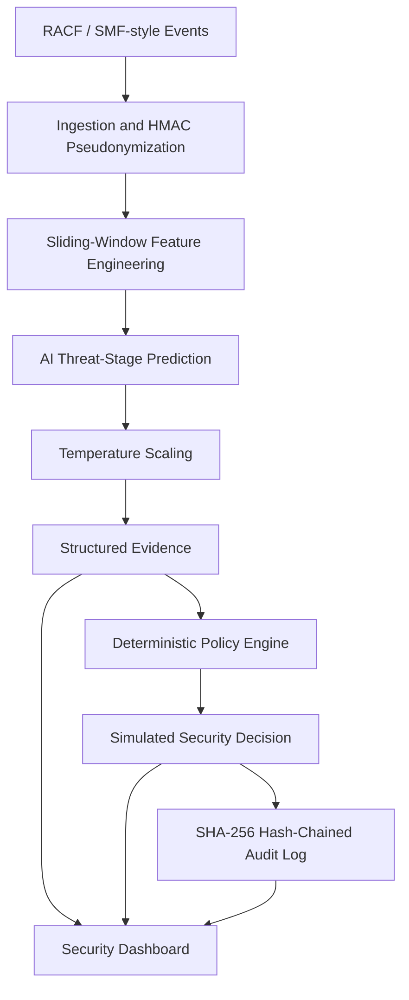
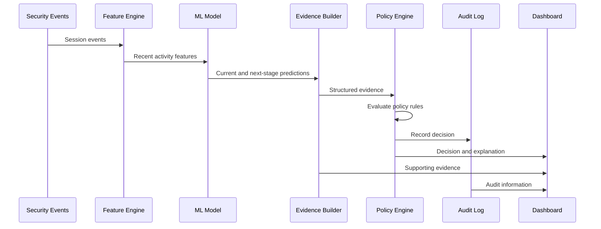

# Threshold — Predictive Threat Intelligence for IBM Z

**Predict the Threat. Explain the Decision. Keep Every Action Accountable.**

Threshold is an AI-powered threat prediction and decision-support prototype designed to complement existing IBM Z security monitoring systems.

It analyzes sequences of security events, predicts current and potential next attack stages, generates supporting evidence, and evaluates that evidence through a separate deterministic policy engine. Decisions are recorded in a tamper-evident audit trail.

> **Project status:** Prototype using synthetic security events. Security responses are simulated; this is not a production-ready intrusion-prevention system.

## Key Features

- Sequence-aware threat analysis using sliding-window features.
- Current and next attack-stage prediction.
- Confidence calibration using temperature scaling.
- Structured evidence with supporting indicators.
- Deterministic, versioned policy decisions.
- Human review for low-confidence predictions.
- Fail-safe log-only behavior when the policy engine encounters an error.
- HMAC pseudonymization of user identifiers.
- SHA-256 hash-chained audit logging and integrity verification.
- Attack and legitimate-administrator demonstration scenarios.
- Deployment on IBM LinuxONE with temporary public access through Cloudflare Quick Tunnel.

## Problem Statement

Attackers using stolen credentials can perform actions that individually resemble legitimate administrative operations. Detecting malicious intent requires analyzing event sequences and context.

Automated responses based solely on model predictions can cause unnecessary alerts or lock out legitimate users. Threshold addresses this challenge by separating AI predictions from evidence, policy decisions, and auditing.

## System Architecture



### Architecture Components

**Telemetry ingestion:** Processes synthetic RACF/SMF-style security events, grouping events by user and session.

**Privacy:** HMAC pseudonymization replaces user identifiers with pseudonyms.

**Feature engineering:** Sliding-window analysis captures authentication failures, privilege changes, sensitive access, unusual origins, and off-hours activity.

**AI prediction:** LightGBM or logistic regression predicts the current and next likely attack stages.

**Evidence generation:** Combines predicted stages, confidence, severity, supporting indicators, and relevant events.

**Policy engine:** Applies deterministic, versioned rules to decide whether to log, issue an early warning, alert an analyst, or simulate session revocation.

**Audit layer:** Records decisions in a SHA-256 hash-chained log and verifies integrity.

**Dashboard:** Presents the event timeline, predictions, evidence, decisions, and audit information.

## End-to-End Workflow



## Threat-Stage Classification

Threshold uses eight attack-stage categories:

- `BENIGN` — activity classified as benign.
- `INITIAL_ACCESS` — possible initial entry.
- `CREDENTIAL_ACCESS` — possible credential compromise.
- `DISCOVERY` — discovery of systems or resources.
- `PRIVILEGE_ESCALATION` — attempts to obtain elevated privileges.
- `LATERAL_MOVEMENT` — movement between systems.
- `COLLECTION_EXFIL` — collection or possible exfiltration of data.
- `IMPACT` — activity potentially affecting operations, integrity, or availability.

These categories support the prototype's analysis; a prediction alone does not prove an attack occurred.

## Model and Calibration

The model predicts the current stage and most likely next different stage. Temperature scaling calibrates confidence, which is reported separately from severity.

Reported evaluation results for the prototype dataset:

| Metric | Before calibration | After calibration |
|---|---:|---:|
| Current-stage ECE | 6.02% | 3.92% |

These values are dataset-specific and do not guarantee real-world detection performance.

## Policy and Safety

The model produces evidence but never directly executes security actions.

A separate policy engine evaluates the evidence and produces simulated outcomes. Low-confidence predictions can require human review, engine errors default to log-only, and protected IDs and circuit breakers help limit repeated actions.

## Audit Integrity

Every decision is recorded in a SHA-256 hash-chained audit log. Each entry includes a reference to the preceding entry's hash, allowing the verifier to detect changes to recorded entries.

Hash chaining provides tamper evidence, not absolute protection against an attacker who can rewrite the entire log and its trusted reference state.

## Demonstration Scenarios

**Credential-compromise attack:** Synthetic events represent suspicious activity progressing through authentication, privilege, or sensitive-access patterns.

**Legitimate administrator look-alike:** Synthetic events represent an on-call administrator performing an emergency change.

The demonstration illustrates how evidence and deterministic policy checks can distinguish suspicious activity from potentially legitimate behavior.

## Technology Stack

| Technology | Purpose |
|---|---|
| Python | Application and pipeline logic |
| pandas | Event processing |
| scikit-learn | Machine-learning utilities and evaluation |
| LightGBM | Predictive model option |
| jsonschema | Evidence validation |
| Streamlit | Original interactive console |
| Python standard library | Lightweight custom dashboard |
| IBM LinuxONE | Deployment environment |
| SSH / PuTTY | Remote administration and local port forwarding |
| Cloudflare Quick Tunnel | Temporary public HTTPS access |

The lightweight custom dashboard provides a demonstration path for the `s390x` environment where dependencies required by the original Streamlit interface were not practical to install.

## IBM LinuxONE Deployment

The current demo runs a Python dashboard on port `8501` on IBM LinuxONE.

### Start the dashboard

```bash
cd ~/shared/Threshold-deploy
nohup python3 public_dashboard.py >/tmp/threshold-dashboard.log 2>&1 </dev/null &
```

### Verify health

```bash
curl -i http://127.0.0.1:8501/health
```

Expected response:

```json
{"status":"ok"}
```

### Configure SSH forwarding

In PuTTY, open **Connection → SSH → Tunnels** and configure:

- Source port: `8501`
- Destination: `127.0.0.1:8501`
- Type: `Local`

Click **Add**, reconnect, and keep the SSH session open.

In Windows PowerShell, verify the forwarded connection:

```powershell
curl.exe -i http://127.0.0.1:8501/health
```

### Start Cloudflare Quick Tunnel

In a separate Windows PowerShell window:

```powershell
& "$env:USERPROFILE\Downloads\cloudflared.exe" tunnel --url http://127.0.0.1:8501
```

Open the generated `https://....trycloudflare.com` URL.

The SSH session and Cloudflare process must remain running. Quick Tunnel URLs are temporary and may change after restarting the tunnel.

## Security Considerations

- Use synthetic or approved test data.
- Never commit credentials, private keys, tokens, or HMAC secrets.
- Protect server access and audit storage.
- Do not expose unauthenticated management endpoints.
- Treat pseudonymized identifiers as potentially sensitive.
- A public HTTPS tunnel does not automatically provide application authentication.
- Keep simulated actions separate from production enforcement.

## Limitations

Threshold is a demonstration prototype using synthetic security events and simulated responses. It has not established production-grade detection accuracy or live IBM Z enforcement capabilities.

Production deployment would require representative validation data, security testing, stronger access controls, operational monitoring, and integration testing.

## Future Improvements

- Integrate authorized live telemetry sources.
- Expand validation across representative benign and attack scenarios.
- Add model-drift monitoring.
- Introduce role-based access control.
- Protect audit checkpoints using independently controlled storage.
- Add regression tests and replayable security scenarios.

## Conclusion

Threshold demonstrates how predictive machine learning can complement existing IBM Z monitoring without allowing a model prediction to directly dictate a response.

By combining sequence-aware analysis, calibrated confidence, structured evidence, deterministic policies, and tamper-evident auditing, Threshold aims to make security investigations more explainable, controlled, and accountable.

**Threshold — Predict the Threat. Explain the Decision. Keep Every Action Accountable.**
