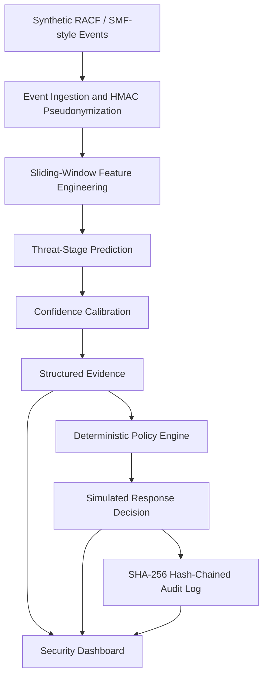
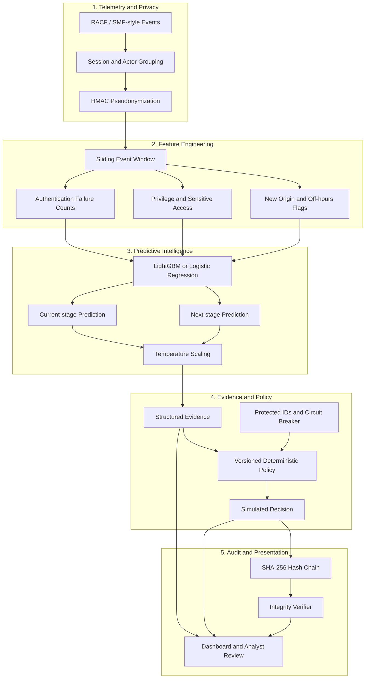
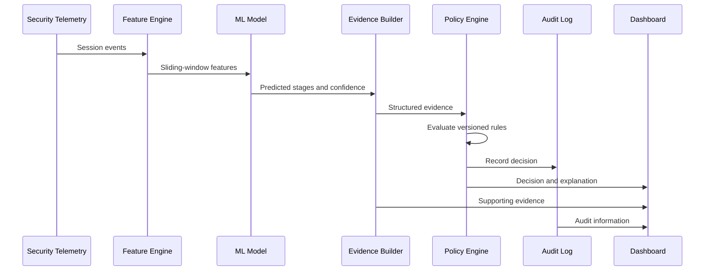
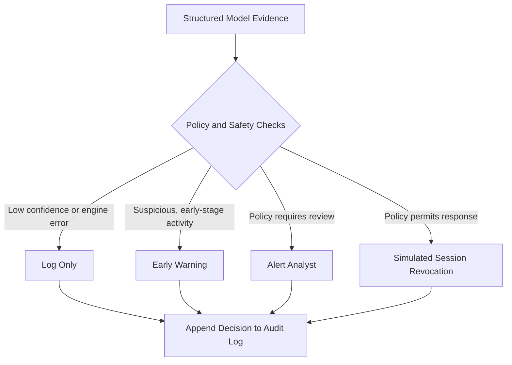
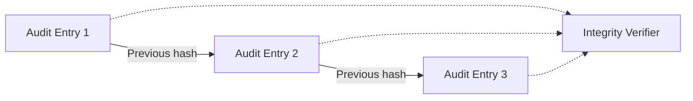
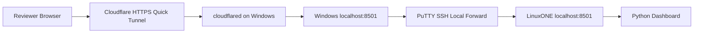

# Threshold — Predictive Threat Intelligence for IBM Z

<p align="center">
  <strong>Predict the Threat. Explain the Decision. Keep Every Action Accountable.</strong>
</p>

<p align="center">
  AI-assisted threat-stage prediction · Deterministic security policies · Tamper-evident auditing · IBM LinuxONE
</p>

---

## Overview

**Threshold** is an AI-powered threat prediction and decision-support prototype designed to complement existing IBM Z security monitoring systems.

Attackers using stolen credentials can perform actions that appear legitimate individually. Threshold analyzes sequences of security events to identify suspicious behavior, predict the current and next likely attack stages, generate supporting evidence, and evaluate that evidence through a separate policy engine.

Unlike systems that allow a model score to directly trigger an action, Threshold separates **prediction, evidence, policy decisions, and auditing**.

The result is a more explainable security workflow in which low-confidence predictions can be escalated for human review, policy failures default to log-only behavior, and decisions can be checked for audit-log tampering.

> **Project status:** Research and demonstration prototype using synthetic security events. Security responses shown in the demo are simulated. Threshold is not a production-ready intrusion-prevention system.

## Key Features

- **Sequence-aware threat analysis:** Examines recent activity rather than isolated security events.
- **Attack-stage prediction:** Predicts the current stage and the most likely next stage.
- **Confidence calibration:** Uses temperature scaling to improve the reliability of confidence estimates.
- **Explainable evidence:** Connects predictions with supporting indicators and relevant events.
- **Policy-controlled responses:** Keeps model predictions separate from simulated security actions.
- **Fail-safe behavior:** Policy-engine errors default to log-only.
- **Protected identities:** Uses HMAC pseudonyms for user identifiers.
- **Tamper-evident audit trail:** Links decisions using SHA-256 hashes.
- **Scenario comparison:** Demonstrates credential compromise alongside a legitimate emergency administrator change.
- **IBM LinuxONE deployment:** Runs a lightweight Python dashboard on an IBM Z-compatible Linux environment.
- **Public demonstration:** Uses SSH local port forwarding and Cloudflare Quick Tunnel for temporary HTTPS access.

## Problem Statement

Mainframes support critical banking, healthcare, government, and enterprise workloads. When an attacker obtains valid credentials, malicious activity may resemble normal administrative operations.

A single failed authentication, privilege change, or sensitive-data access may not establish malicious intent. The sequence and context of these events provide stronger evidence.

Automated responses based solely on a model prediction can also create operational risks, including locking out legitimate administrators or disrupting critical workloads.

Threshold addresses this challenge through a reasoning layer that predicts attack progression, presents evidence, applies deterministic policies, and records decisions for later verification.

## Solution at a Glance



The model generates predictions and evidence. The policy engine determines the simulated response. The audit layer records the resulting decision.

## System Architecture

### Architecture layers

| Layer | Responsibility |
|---|---|
| Telemetry ingestion | Accepts synthetic security events and groups them by user and session. |
| Privacy layer | Replaces user IDs with HMAC pseudonyms. |
| Feature engineering | Calculates recent activity patterns using sliding windows. |
| AI prediction | Predicts the current and next attack stages. |
| Calibration and evidence | Reports calibrated confidence, severity, indicators, and supporting events. |
| Policy engine | Applies deterministic, versioned rules to the evidence. |
| Response simulation | Represents outcomes such as logging, warnings, analyst alerts, or session revocation. |
| Audit and verification | Records decisions in a hash-chained log and checks integrity. |
| Presentation layer | Displays events, evidence, decisions, and audit results. |

### Detailed component diagram



**Important design principle:** AI output is evidence, not authorization. The policy engine is the component responsible for producing the decision.

## End-to-End Data Flow



The pipeline is designed to preserve the distinction between what the model predicts, what the evidence supports, and what the policy permits.

## Threat-Stage Taxonomy

Threshold uses eight attack-stage categories:

| Stage | Description |
|---|---|
| `BENIGN` | Activity consistent with the benign class. |
| `INITIAL_ACCESS` | Possible initial entry into an environment. |
| `CREDENTIAL_ACCESS` | Possible credential theft or compromise. |
| `DISCOVERY` | Attempts to discover systems, resources, or permissions. |
| `PRIVILEGE_ESCALATION` | Attempts to obtain elevated privileges. |
| `LATERAL_MOVEMENT` | Movement between systems or security boundaries. |
| `COLLECTION_EXFIL` | Collection or possible exfiltration of sensitive information. |
| `IMPACT` | Activity potentially affecting availability, integrity, or operations. |

These labels describe the prototype's threat taxonomy. A prediction is not proof that an attack has occurred.

## Feature Engineering

The feature engine analyzes recent session activity through a sliding window.

Potential features include:

- Authentication failure counts.
- Privilege-change counts.
- Sensitive-resource access counts.
- New or unusual access origins.
- Off-hours activity indicators.
- Event ordering and recent behavioral changes.

User identifiers are pseudonymized at ingestion using HMAC. The implementation should keep HMAC secrets outside source control and must not treat pseudonymization as a replacement for access controls.

## Predictive Model and Calibration

Threshold's model design supports a lightweight classifier such as LightGBM or logistic regression.

The model predicts:

- **Current stage:** The most likely current attack-stage category.
- **Next stage:** The most likely next different stage.
- **Confidence:** The model's estimated confidence in its prediction.
- **Severity:** A separate assessment used by the decision workflow.

Temperature scaling is used to calibrate confidence using validation data.

Calibration can be evaluated using Expected Calibration Error (ECE). The following values were reported for the evaluated prototype dataset:

| Metric | Before calibration | After calibration |
|---|---:|---:|
| Current-stage ECE | 6.02% | 3.92% |

These are dataset-specific reported results, not guarantees of real-world performance. Model quality also depends on representative data, class balance, validation methodology, and distribution changes.

## Evidence and Policy Decisions

The model produces structured evidence containing the predicted stages, confidence, severity, relevant indicators, and supporting events.

A separate deterministic, versioned policy engine evaluates this evidence.



The actual decision depends on the configured rules and available evidence. The diagram illustrates possible policy outcomes, not a guarantee that a particular event will produce a specific response.

Safety mechanisms include:

- Human review for low-confidence predictions.
- Log-only behavior when the policy engine encounters an error.
- Protected identifiers to reduce the risk of inappropriate lockouts.
- A circuit breaker to limit repeated actions.
- Versioned rules for traceability and reproducibility.

**The prototype simulates security actions; it does not automatically revoke real production sessions.**

## Audit Integrity

Threshold uses a SHA-256 hash-chained audit log.

Conceptually, each record contains the decision data, the previous record's hash, and the hash of the current record.



If a previously recorded entry is changed, its hash or the subsequent chain verification should fail. The verifier can identify the affected line or entry.

A hash chain provides tamper evidence, not absolute protection against an attacker who can rewrite the entire log and its trusted reference state. Stronger production auditing would require protected storage, restricted write access, and independently retained checkpoints.

## Demonstration Scenarios

Threshold uses synthetic security events to compare two scenarios.

### Credential-compromise attack

A session exhibits suspicious activity, such as authentication failures followed by privilege changes or sensitive access. The pipeline evaluates the sequence, generates evidence, and applies the configured policy.

### Legitimate administrator look-alike

An on-call administrator performs an emergency change that may resemble suspicious behavior. Threshold demonstrates why contextual evidence and policy checks are necessary before escalating a response.

The objective is to identify suspicious progression early while avoiding unnecessary responses to legitimate operations.

## Dashboard Screenshots

Place your real screenshots in the `docs/images/` directory and update the filenames below to match the actual files you add.

### Main dashboard

The dashboard provides the main entry point for reviewing the prototype's security analysis.


### System architecture

The architecture diagram shows the relationship between event ingestion, feature engineering, prediction, policy decisions, and auditing.


### Model calibration

The calibration graph compares the reported ECE before and after temperature scaling.


### Event timeline and evidence

The console presents event progression, predicted stages, confidence, severity, and supporting indicators.


### Policy decisions

The policy view presents the simulated decisions produced by the deterministic policy engine.


### Audit trail and verification

The audit view demonstrates recorded decisions and the hash-chain integrity-check workflow.


### IBM LinuxONE deployment

The terminal screenshot documents the dashboard launch and health-check process on the LinuxONE environment.


### Public demo access

The deployment screenshot can document the Cloudflare Quick Tunnel URL and browser access to the dashboard. Do not include private keys, credentials, tokens, or sensitive logs.


> **Screenshot note:** These Markdown references are placeholders. Add the actual images to the repository using these filenames, or change the references to match your screenshot names. GitHub will not display images that have not been committed to the referenced paths.

## Technology Stack

| Technology | Purpose |
|---|---|
| Python | Application and pipeline logic |
| pandas | Tabular event processing |
| scikit-learn | Machine-learning utilities and evaluation |
| LightGBM | Lightweight predictive model option |
| jsonschema | Structured evidence validation |
| Streamlit | Original interactive console design |
| Python standard library | Lightweight custom dashboard server |
| IBM LinuxONE | Demonstration deployment environment |
| SSH / PuTTY | Secure remote administration and local port forwarding |
| Cloudflare Quick Tunnel | Temporary public HTTPS access to the demo |

The deployment environment uses the `s390x` architecture. The custom dashboard provides a lightweight demonstration path where dependencies required by the original Streamlit interface are not available or practical to install.

## Deployment Architecture

The current demonstration exposes the dashboard through a Windows-hosted Cloudflare tunnel connected to an SSH local port forward.



**Connection flow:**

1. The Python dashboard runs on IBM LinuxONE on port `8501`.
2. PuTTY forwards Windows local port `8501` through SSH to the server's port `8501`.
3. Cloudflare Quick Tunnel exposes the Windows local endpoint using a temporary HTTPS URL.
4. Reviewers open that URL in their browsers to view the dashboard.

The dashboard should be reachable locally before starting Cloudflare.

## Deployment Instructions

### Start the dashboard on LinuxONE

Connect to the server using PuTTY and run:

```bash
cd ~/shared/Threshold-deploy
```

Start the lightweight dashboard:

```bash
nohup python3 public_dashboard.py \
  >/tmp/threshold-dashboard.log 2>&1 </dev/null &
```

Check its health endpoint:

```bash
curl -i http://127.0.0.1:8501/health
```

Expected response includes:

```json
{"status":"ok"}
```

If the service does not respond, inspect its log:

```bash
cat /tmp/threshold-dashboard.log
```

Check whether the service is listening:

```bash
ss -ltnp | grep 8501
```

### Configure SSH local port forwarding

In PuTTY, open **Connection → SSH → Tunnels** and configure:

| Setting | Value |
|---|---|
| Source port | `8501` |
| Destination | `127.0.0.1:8501` |
| Tunnel type | Local |

Click **Add**, then reconnect to the server and keep the SSH session open.

In Windows PowerShell, verify the forwarded port:

```powershell
curl.exe -i http://127.0.0.1:8501/health
```

Proceed only when this returns a successful health response.

### Start Cloudflare Quick Tunnel

In a separate Windows PowerShell window, run:

```powershell
& "$env:USERPROFILE\Downloads\cloudflared.exe" tunnel --url http://127.0.0.1:8501
```

Copy the generated `https://....trycloudflare.com` URL and open it in your browser.

Keep both the SSH session and Cloudflare process running while the demo is in use. Quick Tunnel URLs are temporary and may change after restarting the tunnel.

### Deployment troubleshooting

| Symptom | Check |
|---|---|
| Dashboard health check fails on LinuxONE | Inspect `/tmp/threshold-dashboard.log` and check port `8501`. |
| Windows cannot connect to `localhost:8501` | Confirm PuTTY's local tunnel entry was added and the SSH session is connected. |
| Cloudflare displays 502 | Verify the Windows health check first, then inspect tunnel connectivity. |
| Public URL stops working | Confirm the dashboard, SSH session, and Cloudflare process are still running. |
| URL changes after restart | Use the newly generated Quick Tunnel URL. |

## Security Considerations

- Use synthetic or approved test data in the public demo.
- Never commit private keys, passwords, HMAC secrets, access tokens, or production security records.
- Keep SSH private keys private and use appropriate server access controls.
- Treat pseudonymized identifiers as potentially sensitive.
- Restrict public access when the dashboard contains internal information.
- Do not expose unauthenticated management or action endpoints.
- Keep simulated actions separate from production enforcement.
- Use protected storage and access controls for production audit logs.
- A temporary HTTPS tunnel does not, by itself, provide application authentication or authorization.

## Current Scope and Limitations

Threshold is a prototype designed to demonstrate a security reasoning workflow. Its current demonstration uses synthetic SMF-style events and simulated responses.

The prototype does not establish production-grade detection accuracy, integration with a live IBM Z security-monitoring feed, or authorization to perform real session revocations.

Before production use, the system would need representative validation data, security testing, operational monitoring, stronger access controls, failure testing, and integration testing against the target IBM Z environment.

## Future Improvements

- Integrate authorized live telemetry sources.
- Evaluate model performance across representative attack and benign scenarios.
- Add drift monitoring and scheduled model evaluation.
- Strengthen analyst authentication and role-based access control.
- Store audit checkpoints in a separately protected system.
- Add policy testing, replayable scenarios, and regression tests.
- Improve operational metrics and incident investigation workflows.

## Conclusion

Threshold demonstrates how predictive machine learning can complement existing IBM Z security monitoring without allowing a model prediction to directly dictate a response.

By combining sequence-aware features, calibrated predictions, structured evidence, deterministic policy decisions, and tamper-evident auditing, Threshold aims to make security investigations more understandable, controlled, and accountable.

**Threshold — Predict the Threat. Explain the Decision. Keep Every Action Accountable.**
